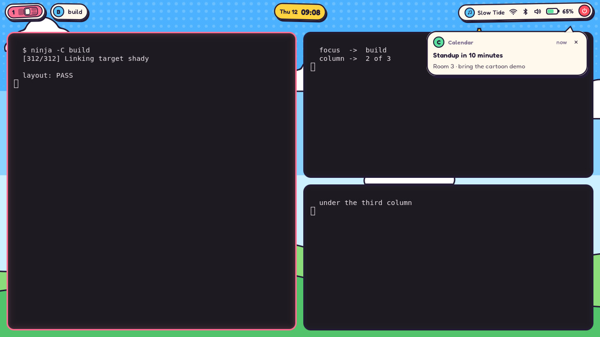
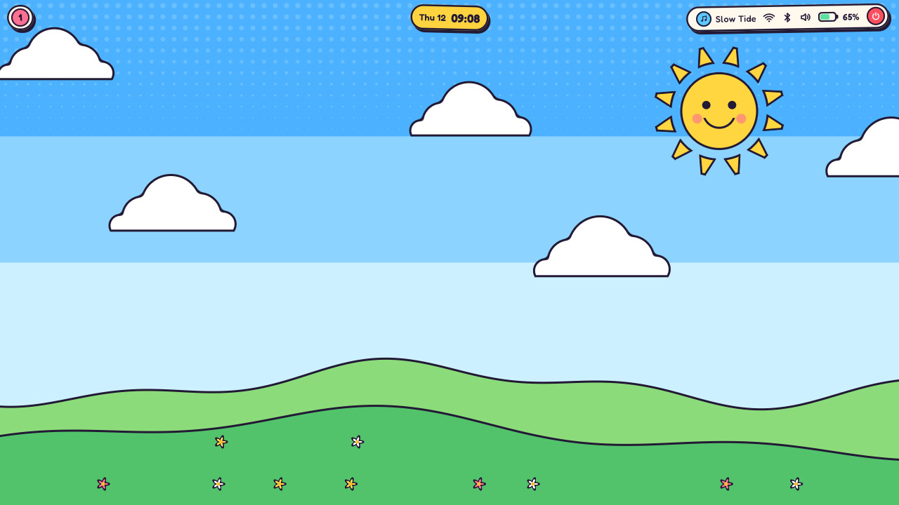
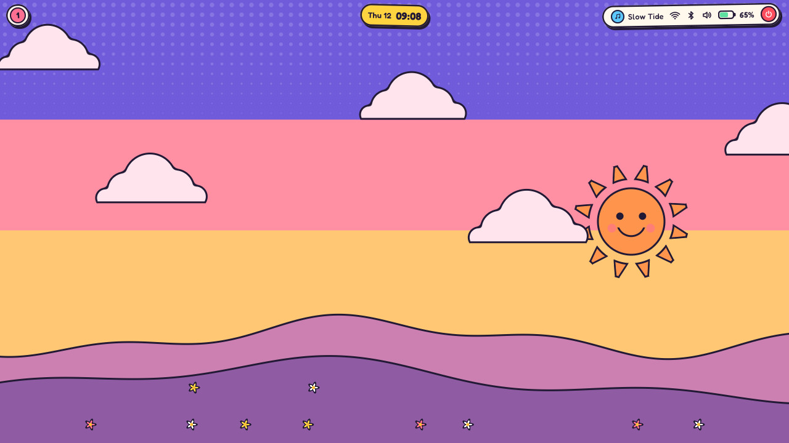
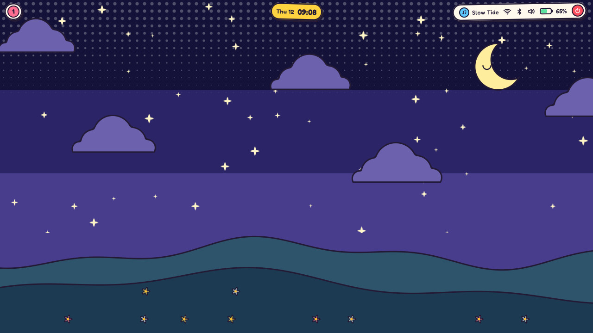
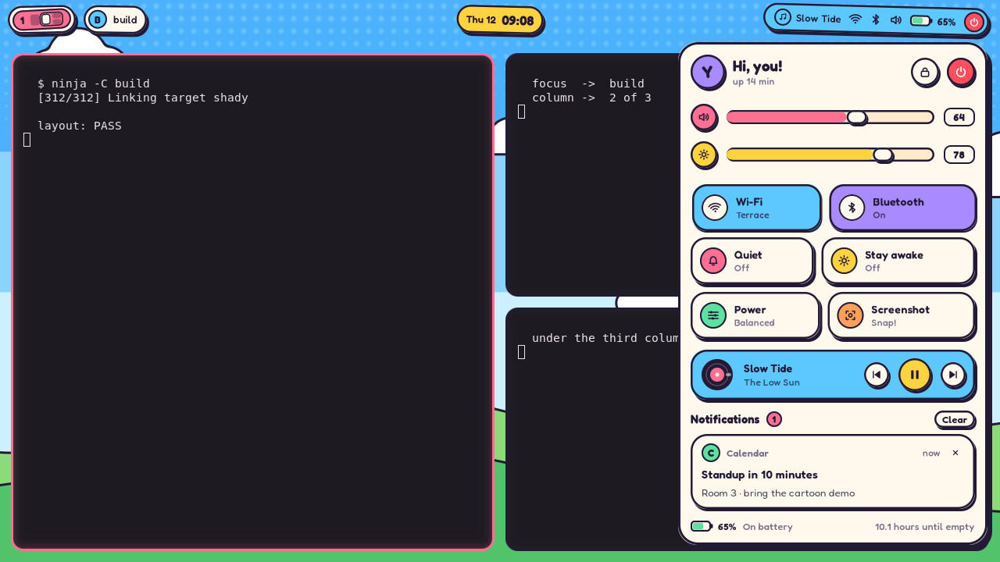
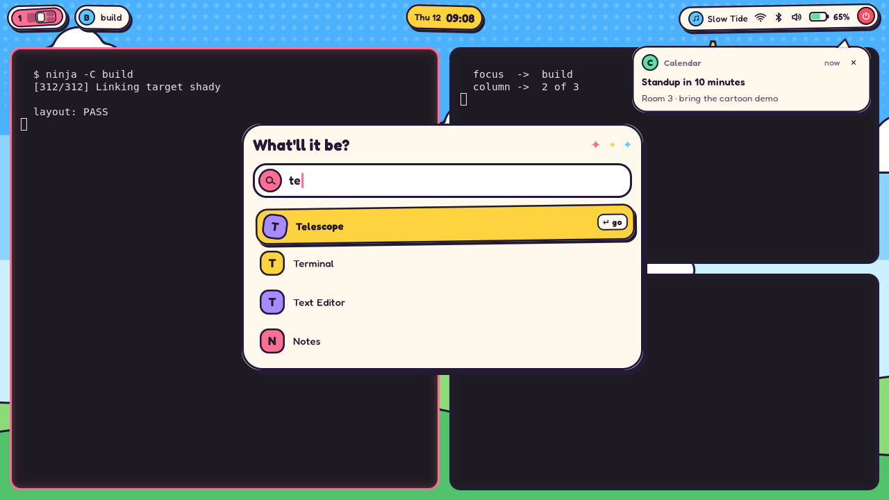
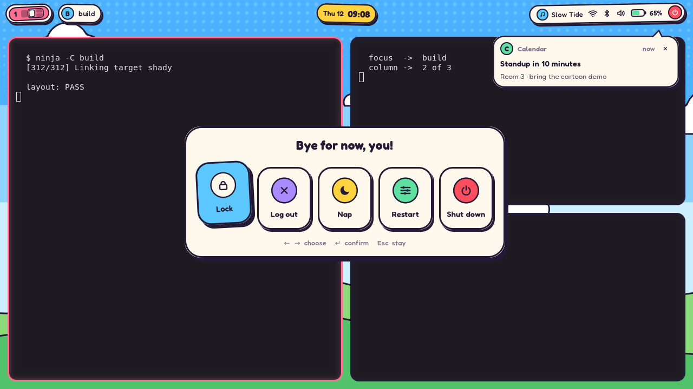
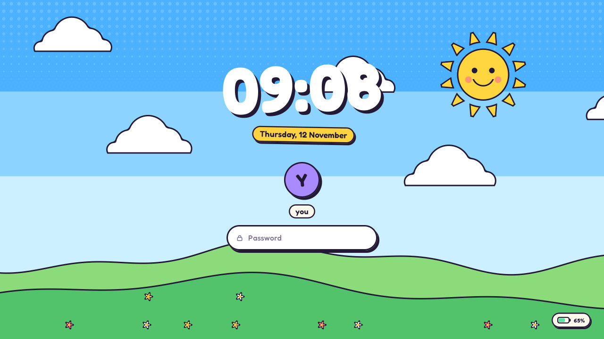

# Toon



A cartoon desktop for [Shady](https://github.com/gloaming-dusk/shady).
Everything the shell draws is a sticker cut from paper, with a thick ink
outline and a hard shadow, and everything moves on bouncy springs: panels
pop in small and crooked and settle with an overshoot, buttons lift under
the pointer and are pressed into the paper when switched on.

Toon's windows, keys and rules are
[Tide](https://github.com/gloaming-dusk/shady/tree/main/rices/tide)'s:
`config.lua` and `init.lua` start from `shady.base("tide")`, so the strip of
columns that scrolls sideways and niri's keys work exactly as there. Toon
draws the windows with a thick ink outline and a bubblegum one around the
focused window. The shell (`shell.lua`, `style.lua`) and the sky
(`shaders/toon.frag`) are its own.

## The sky



The wallpaper is a cartoon sky over rolling hills, and it follows the clock:

- **day**: a smiling sun that turns its rays and blinks every few seconds,
- **dusk** (around 6 and 18 o'clock): the sun sinks, orange, into a pink and
  purple sky,
- **night**: a sleepy crescent moon and twinkling stars.

Puffy clouds drift across all day long, and the top of the sky is printed
in halftone dots like a comic book.

| | |
|---|---|
|  |  |

The moving sky redraws the screen on every frame. `TOON_STILL=1` stops the
clock: the sky is then drawn once and costs nothing afterwards (it still
changes with the hour). `TOON_HOUR=19` shows a given hour instead of the
clock's.

As with Tide, the sky stays until something replaces it through
shady-shell's wallpaper manager: a picture chosen in Gloam's Settings, one
saved as `~/.config/shady/wallpaper.jpg` (or `.png`, `.webp`), a folder
`~/.config/shady/wallpapers` (a slideshow), or `shady-wallpaper set PATH`.

## The shell

- **Bar**: three stickers stuck on the top edge, each a little crooked. The
  workspaces are candy bubbles, each number its own colour, and the current
  one carries a minimap of the strip. The focused window's title sits next to
  them. In the middle the clock (click: a calendar); on the right what is
  playing, Wi-Fi, Bluetooth, volume (scroll to change it), a cartoon battery
  and a power button that spins round under the pointer.
- **Control center** (`Super+S`, or click the status sticker): chunky
  sliders for volume and brightness, big tiles for Wi-Fi, Bluetooth, quiet
  mode, stay awake, the power profile and a screenshot, what is playing on a
  little record that ticks round, and the notifications.

  

- **Notifications** arrive as speech bubbles from the status sticker.
- **Launcher** (`Super+Space`): applications ordered by how often you
  launch them; `= 12*7` calculates (Enter copies the result), `> cmd` runs
  a command, and "lock", "nap", "restart" match the session's commands.
  Typing Hangul works.

  

- **Power menu** (`Super+Shift+E`): five candy buttons; the chosen one jumps.

  

- **Calendar** (click the clock): today circled in bubblegum.
- **OSD**: volume and brightness keys show a sticker at the bottom, its icon
  hopping on every press.
- **Screenshots** (`Print`): drag a region, click a window or take the
  screen; `Tab` or `R`, `W`, `S` change mode, `Esc` cancels.
- **Lock screen** (`Super+Alt+L`, and after five minutes idle): the clock on
  a title card over the sky, checked with PAM, with the fingerprint reader
  listening at the same time when there is one. Each typed character is a
  candy dot; a wrong password shakes the field.

  

`Super+Shift+/` lists every key.

The type is [Fredoka](https://fonts.google.com/specimen/Fredoka), with
[Jua](https://fonts.google.com/specimen/Jua) for Hangul, both under the SIL Open
Font License (`fonts/`).

## Use it

Toon needs [Shady](https://github.com/gloaming-dusk/shady) (which ships
Tide's compositor side) and
[shady-shell](https://github.com/gloaming-dusk/shady-shell).

On NixOS, add this flake's package to `programs.shady.rices` and set
`programs.shady.rice = "toon";`:

```nix
{
  inputs.toon.url = "github:jihoo12/shady-rice-toon";
  # ...
  programs.shady.rices = [ inputs.toon.packages.${pkgs.system}.default ];
  programs.shady.rice = "toon";
}
```

Elsewhere, `./install.sh` links this checkout into
`~/.local/share/shady/rices/toon`; then start Shady with `SHADY_RICE=toon`.

To try it from a checkout, next to built `shady` and `shady-shell`
checkouts (or with `SHADY_ROOT` and `SHADY_SHELL_BIN` pointing at them):

```bash
nix develop ../shady -c ./run.sh          # nested in a Wayland session
nix develop ../shady -c ./run-native.sh   # directly on a VT (DRM + libinput)
```

The shell uses the same optional tools as Tide when they are installed:
`wpctl`, `nmcli`, `bluetoothctl`, `powerprofilesctl`, `playerctl`, `upower`,
`grim`, `wl-copy` and `swaylock` (when shady-shell cannot lock by itself).

## Building on it

A config can start from Toon and change a few things:

```lua
local toon = shell.base("toon", {
    palette = { accent = "#FF9F5A", paper = "#FFFDF5" },
    bar = { right = function(ctx) return toon_extra(ctx) end },
})
```

The options are `palette` (the names in `style.lua`), `wallpaper`, `bar`,
`tiles` and `launcher`, as in Tide; it returns its pieces (`sticker`,
`panel`, `island`, `tile`, `slider`, `sys`, `act`, ...). The accent chosen in
Gloam's Settings is Toon's bubblegum.

## Pictures

`capture.sh` regenerates everything in `docs/`. It runs the rice headless
on a private session bus, with the stand-ins for the system tools and the
fixed set of applications from
[Horizon](https://github.com/gloaming-dusk/shady-rice-horizon)'s
`capture/`, and Afterglow's terminal colours:

```bash
nix develop ../shady -c ./capture.sh
```

## License

Apache License 2.0 (`LICENSE`). The fonts are under the SIL Open Font
License 1.1 (`fonts/OFL-*.txt`).
